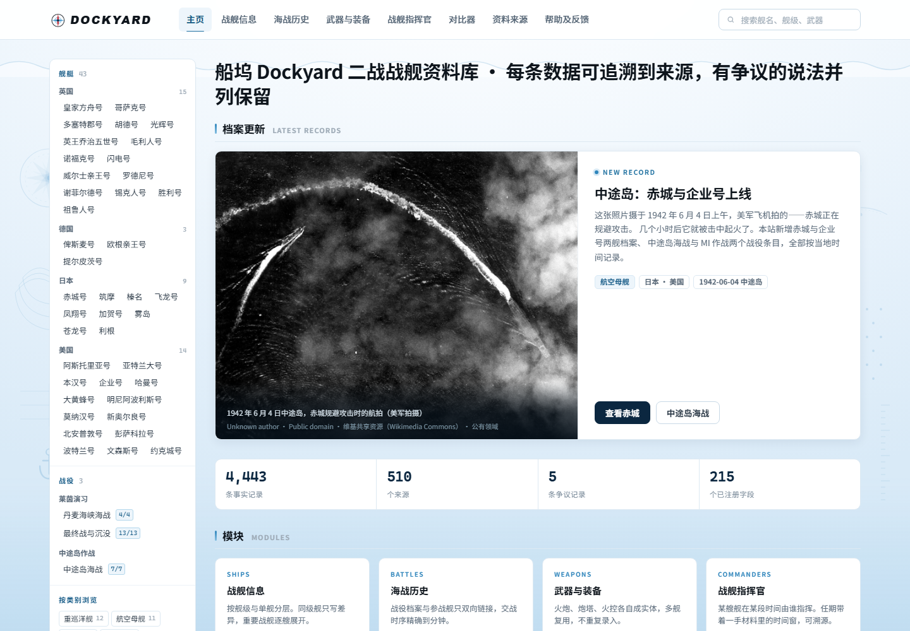

# Dockyard · 船坞

> 一座二战战舰资料库。**每条数据带时间窗和来源，有争议的说法并列保留，而不是挑一个写上去。**

在线站点：<https://archive.dockyard.workers.dev>



---

## 这是什么

同题材的资料站大多是「一艘舰一个页面，参数列一张表」。做深之后会发现三个问题：

1. **参数会随时间变。** 俾斯麦号从服役到沉没只有 9 个月，但雷达、迷彩、编制、防空炮位都变过。写成一张静态表，等于把一段历史压成了一个瞬间。
2. **史料会互相矛盾。** 排水量、航速、击沉归属，不同来源给出不同数字是常态。多数站点选一个写上去，读者不知道还有别的说法。
3. **说不清哪来的。** 数字摆在那里，没人知道出自哪份档案、几级证据、什么时候采的。

这个项目是把这三点当数据模型来解，而不是当编辑规范来解：

### 字段级时间窗，不是整舰快照

每个会变的数据点存成一条 `fact`，带 `valid: { from, to }` 时间窗。查某个时刻的某个字段，就是在这个窗上做一次筛选。时间轴可以拖动，整站所有数值跟着那一刻重算。

不存「1941-05 的整舰快照」，因为几百艘船乘以十几次改装就会数据爆炸，而且各份快照之间必然互相漂移。

### 分歧是一等公民

同 `field` + 同时间窗出现多条记录，**自动构成分歧**——不需要额外标记位。渲染时给主值加角标，其余说法原样保留、可展开对比。

主值的选取规则写死（证据层级 → 口径明确度 → 采集时间），但主值只是**默认显示值，不是"正确答案"**。

### 每条数据可点开溯源

`src` 必填，没有来源的 fact 构建直接失败。每条来源登记证据层级（A 一手档案 / B 同期官方出版物 / C 权威二次文献 / D 专题网站 / E 百科）、采集日期和核对位置。

站内任何数值旁边都能看到它是从哪儿来的。

### 对比器是数据模型的副产物

字段在 `data/fields.yaml` 里注册，带 `compare: true` 的字段自动进入对比表。加一艘新舰、加一个新字段，对比器不需要写任何新代码。

---

## 数据规模

| 项 | 数量 |
|---|---|
| 战舰 / 舰级 | 43 艘 / 28 级 |
| 事实记录（`fact`） | 4,400+ 条 |
| 已注册字段 | 215 个 |
| 登记来源 | 510 条 |
| 争议记录（`narrative`） | 5 条 |
| 图片索引 | 720+ 张 |

数字随提交增长，以[站点首页](https://archive.dockyard.workers.dev)的实时统计为准。

---

## 快速开始

环境要求：Node.js 18+，Python 3.10+（只有校验脚本用到 Python）。

```bash
git clone https://github.com/Mizuki-77/dockyard.git
cd dockyard

npm install
python -m pip install -r requirements.txt

npm run dev          # http://localhost:4321
```

构建与校验：

```bash
npm run build        # 产出静态站点到 dist/
npm run validate     # 数据层全量校验
python scripts/selftest.py   # 校验器自测
```

> 仓库里的图片资产约 167 MB。只关心数据层的话可以用 `git clone --depth 1` 或稀疏检出。

---

## 目录结构

```
data/                数据层，全站唯一真相来源（262 个 YAML）
├── ships/           单舰档案（只写与舰级的差异）
├── classes/         舰级公共数据
├── slices/          状态切片：某舰在某时间点的构型
├── battles/         战役与行动记录
├── commanders/      指挥官任期，带时间窗
├── articles/        舰船长文
├── weapon-articles/ 武器长文（107 篇）
├── narratives/      争议叙述：多种说法并列
├── fields.yaml      字段注册表（215 个字段，驱动渲染与对比）
├── sources.yaml     来源登记（510 条，带证据层级与采集日期）
└── images.yaml      图片索引（720+ 张，带授权与 credit）

src/
├── pages/           Astro 路由（ships / classes / battles / weapons /
│                    commanders / operations / compare / sources / help）
├── lib/             数据读取与解析（data.ts / resolve.ts / catalog.ts / tree.ts）
├── components/      渲染组件
└── layouts/         页面骨架

scripts/
├── validate.py      数据层校验：字段合法性、时间窗、来源必填、交叉引用
├── selftest.py      校验器自测（防止校验器本身坏了没人知道）
└── check_auth.ps1   本机推送凭据自检

docs/                设计与运维文档（00 框架 / 10 部署 / 30 新增舰船流程 …）
.github/workflows/   每周数据健康自检
```

---

## 数据长什么样

一条 `fact` 的完整形态：

```yaml
- field: displacement.standard     # 必须存在于 data/fields.yaml
  value: 41700
  unit: t
  src: [kbismarck-bsweights]       # 至少一个来源，否则构建失败
  valid: { from: 1940-08-24, to: 1941-05-27 }   # 时间窗必填
  confidence: A
  note: 德方标准排水量口径
```

字段注册表里的定义：

```yaml
- id: speed.max
  label: { zh: 最大航速, en: Maximum speed }
  type: number
  unit: kn
  group: 动力
  compare: true        # 自动进入对比器
  better: higher       # none | higher | lower | context
```

`better: context` 用来标记「不是越大越好」的字段（比如装甲厚度——布置方式和倾角同样重要），渲染时不做高低着色。

完整数据模型见 [docs/00-framework.md](docs/00-framework.md)。

---

## 增补一艘舰的流程

见 [docs/30-new-ship-workflow.md](docs/30-new-ship-workflow.md)。简要：

1. 在 `data/sources.yaml` 登记来源，标证据层级与采集日期
2. 写 `data/classes/<class>.yaml`（舰级公共数据）
3. 写 `data/ships/<ship>.yaml`（只写差异）
4. 需要逐状态还原的，加 `data/slices/<ship>.yaml`
5. 图片登记进 `data/images.yaml`（授权与 credit 必填）
6. `npm run validate` 过了再提交

硬规则只有四条：字段必须来自注册表、时间窗必填、来源必填、分歧不许删掉一面。

---

## 部署

站点是纯静态产物，配置见 `wrangler.toml`，当前部署在 Cloudflare Workers：

```bash
npm run deploy       # astro build && wrangler deploy
```

fork 的人可以换成任意静态托管（Netlify、Vercel、GitHub Pages、自己的 Nginx）。
改域名时只需要更新 `astro.config.mjs` 里的 `site` 默认值，或构建时传环境变量：

```bash
PUBLIC_SITE=https://your.domain npm run build
```

---

## 参与

发现数据有误、或者有更权威的来源，请直接开 issue —— 用[「数据纠错」模板](.github/ISSUE_TEMPLATE/correction.yml)。

**请带上你的来源。** 说「这个数字不对」没办法处理；说「NavWeaps 那页写的是 35,550 m，你们写的是 36,520」就能直接变成一条新的证据记录。

两条不接受：

- 删掉有争议的另一面。分歧要并列保留，这是数据模型本身的约定。
- 无来源的修改。校验脚本会拦。

---

## 授权

- **代码**（`src/` `scripts/` 配置等）：[MIT](LICENSE)
- **数据与文档**（`data/` `docs/` 正文）：CC BY-SA 4.0
- **图片**：逐张授权，登记在 `data/images.yaml` 的 `license` / `credit` 字段。绝大部分是公有领域（美国海军档案、维基共享资源）或 CC 授权，转载时请照着索引里的署名要求来。

---

## English

**Dockyard** is a WWII warship database that treats historiography as a data model problem.

Every mutable value is a `fact` with a validity time window and at least one registered source; conflicting accounts of the same field are first-class data (`narrative`) and are never deleted in favour of one reading. Values resolve per-instant, so the timeline can be dragged and the whole site re-renders against that date. A field registry drives rendering, the comparison table, and validation — adding a ship or a field requires no new code.

Built with Astro 5 + a YAML data layer, statically output to Cloudflare Workers. Validation is Python (`scripts/validate.py`) and runs weekly in CI.

Live site: <https://archive.dockyard.workers.dev>
